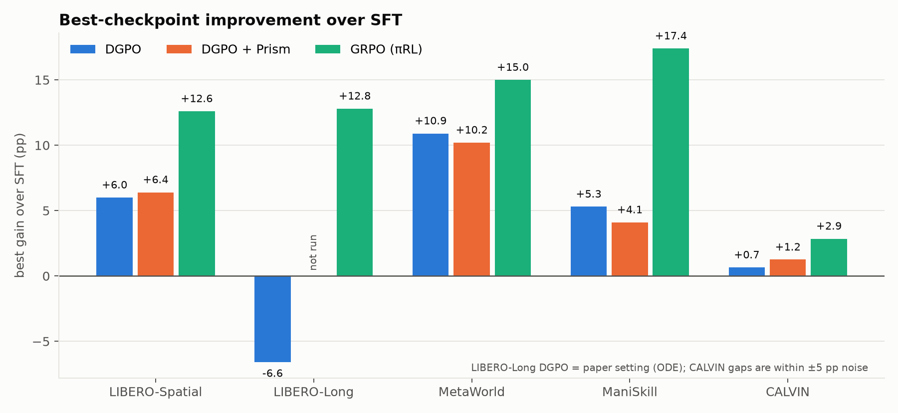
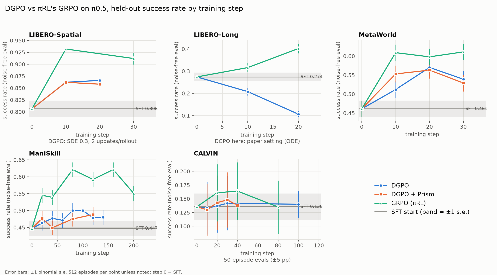
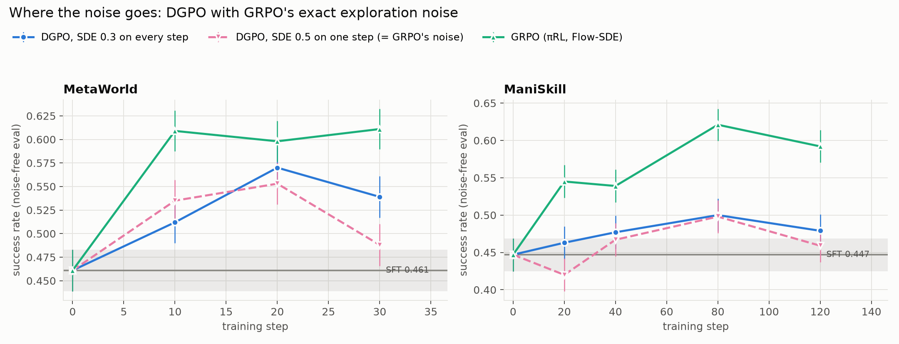

# pirl-dgpo: DGPO in place of πRL's Flow-GRPO update

This repository plugs **DGPO** (Direct Group Preference Optimization,
[arXiv:2510.08425](https://arxiv.org/abs/2510.08425)) into
**πRL** ([arXiv:2510.25889](https://arxiv.org/abs/2510.25889), code:
[RLinf](https://github.com/RLinf/RLinf)). It replaces only the policy update,
Flow-SDE GRPO ([Flow-GRPO, arXiv:2505.05470](https://arxiv.org/abs/2505.05470)),
and fine-tunes the flow-matching VLA **π0.5** on five simulated robot
benchmarks. The model, simulators, rollout workers, reward, group
construction and compute budget all stay as in πRL. The
[Prism-GRPO](#prism-reward) (arXiv:2608.17423) reward (success + λ·smoothness) is included as an
option.

**Result: GRPO beats DGPO on every benchmark.** DGPO as published, with
noise-free ODE rollouts, makes the policy *worse* than its SFT start. With
exploration noise DGPO does improve on SFT, but by less than GRPO. The gap is
not caused by the noise: giving DGPO exactly GRPO's rollouts does not close
it. It is not a tuning problem either (sweep below), and it is not an
implementation difference: our gradient matches the official DGPO code in a
unit test.



---

## Contents

- [Results](#results)
- [Repository layout](#repository-layout)
- [What changed: Flow-GRPO → DGPO, file by file](#what-changed-flow-grpo--dgpo-file-by-file)
- [Setup](#setup)
- [Running](#running)
- [Configuration reference](#configuration-reference)
- [Known issues and cluster notes](#known-issues-and-cluster-notes)
- [Credits and license](#credits-and-license)

---

## Results

Held-out success rate with the **noise-free** sampler, 512 episodes per
checkpoint (±2.2 pp; CALVIN uses 50–200 episodes). "Best" is the best saved
checkpoint (steps 10–80). The budget is the same for every method: 12 h on
4×H100, groups of 8 rollouts per reset state, starting from RLinf's released
SFT checkpoint.

| Benchmark | SFT | DGPO, ODE (as in the paper) | DGPO + SDE noise | DGPO + SDE + Prism | **GRPO (πRL)** |
|---|---|---|---|---|---|
| LIBERO-Spatial | 0.806 | 0.772 | 0.866 | 0.870 | **0.932** |
| LIBERO-Long | 0.274 | 0.208 → 0.106 | – | – | **0.402** |
| MetaWorld MT50 | 0.461 | – | 0.570 | 0.563 | **0.611** |
| ManiSkill pick-place | 0.447 | – | 0.500 | 0.488 | **0.621** |
| CALVIN ABC→D | 0.136 | – | ~0.14 | ~0.14 | 0.164 |

| Control | MetaWorld | ManiSkill |
|---|---|---|
| DGPO with GRPO's exact noise (one random step, level 0.5) | 0.553 | 0.498 |
| GRPO | 0.611 | 0.621 |

MetaWorld one-knob sweep (DGPO + SDE, step 20; base 0.570, GRPO 0.598): lr ×3
0.559, lr ×10 collapsed, β 1e3 0.557, β 1e5 0.539, 4 updates per rollout
0.557, t_min 0.1 0.523.




DGPO's main selling point, a speed-up of about 20–30× over Flow-GRPO on
text-to-image, does not carry over. πRL's step time is dominated by the
simulators, so a cheaper update saves little, and GRPO's steps were in fact
15–35% faster. Slides with the full story are in [slides/](slides/): a
9-slide talk (`dgpo_pirl_short.pdf`) and a 22-slide version with method
details and backups (`dgpo_pirl.pdf`). The raw lab notebook, with every job,
failure and fix, is [docs/EXPERIMENT_LOG.md](docs/EXPERIMENT_LOG.md).

---

## Repository layout

```
rlinf_overlay/        the changed/new RLinf files, at their RLinf-relative paths
patches/              the same changes as one git patch against RLinf 09a74045
scripts/
  setup_rlinf.sh      clone RLinf @ 09a74045 and apply the overlay (or the patch)
  install_envs.sh     build a venv per simulator with RLinf's installer
  fetch_assets.sh     SFT checkpoints, tokenizer, simulator assets
jobs/
  env.sh              site paths: EDIT THIS
  _common.sh          job preamble + preflight (CUDA, GL rendering, DGPO import)
  _ray_start.sh       per-job Ray head (own port block and temp dir)
  train_dgpo.sbatch   DGPO training
  train_grpo.sbatch   πRL GRPO control
  eval.sbatch         held-out noise-free eval of SFT / checkpoints
  smoke.sbatch        2-step plumbing check
  make_dgpo_configs.py  how the DGPO configs were derived from πRL's PPO configs
  make_grpo_configs.py  same, for the GRPO controls on MetaWorld/ManiSkill/CALVIN
  make_eval_configs.py  writes <config>_eval.yaml for benchmarks with no RLinf eval config
figures/              result figures + make_figures.py
slides/               Beamer talk (.tex + .pdf)
docs/EXPERIMENT_LOG.md  lab notebook
```

---

## What changed: Flow-GRPO → DGPO, file by file

Paths are inside RLinf; the links point to the copies in
[rlinf_overlay/](rlinf_overlay/). Line numbers for unchanged upstream files
refer to RLinf commit
[`09a74045`](https://github.com/RLinf/RLinf/tree/09a74045c30b934e7f0811c8a550a1b126332da1).

### The two update rules side by side

| Stage | πRL Flow-SDE GRPO (upstream, unchanged) | DGPO (this repo) |
|---|---|---|
| Config switch | `algorithm.loss_type: actor` | `algorithm.loss_type: embodied_dgpo` ([train_embodied_agent.py:93](rlinf_overlay/examples/embodiment/train_embodied_agent.py#L93)) |
| Worker | `EmbodiedFSDPActor` in `rlinf/workers/actor/embodied_fsdp_actor_worker.py` | `EmbodiedDGPOFSDPPolicy` ([fsdp_dgpo_policy_worker.py:86](rlinf_overlay/rlinf/workers/actor/fsdp_dgpo_policy_worker.py#L86)), a subclass of RLinf's NFT worker `EmbodiedNFTFSDPPolicy` (`fsdp_nft_policy_worker.py:35`), which already collects the clean action chunk |
| Rollout sampler | SDE noise at **one random** denoise step, level 0.5 (`sample_mean_var_val`, `flow_sde` branch, `openpi_action_model.py:1182`) | ODE (as in the paper), SDE on **every** step at 0.3, or GRPO's exact one-step noise via the new `nft_single_noise_step` ([openpi_action_model.py:104](rlinf_overlay/rlinf/models/embodiment/openpi/openpi_action_model.py#L104), [:1050-1052](rlinf_overlay/rlinf/models/embodiment/openpi/openpi_action_model.py#L1050-L1052)) |
| What is stored per chunk | log-prob of the noised denoise step (`get_log_prob_value`, `openpi_action_model.py:1311`; Gaussian in `get_logprob_norm`, :1293) | the clean chunk `nft_x0` ([openpi_action_model.py:1123](rlinf_overlay/rlinf/models/embodiment/openpi/openpi_action_model.py#L1123)). **No likelihood is needed** |
| Advantage | group-normalised reward `(r − mean)/std` (`compute_grpo_advantages`, `advantages.py:90`) | the same GRPO advantage, clipped to ±5 ([worker:302](rlinf_overlay/rlinf/workers/actor/fsdp_dgpo_policy_worker.py#L302)), or the Prism RLOO advantage ([worker:183](rlinf_overlay/rlinf/workers/actor/fsdp_dgpo_policy_worker.py#L183)) |
| Per-sample quantity | recompute log π_θ of the stored step (`train_micro_batch`, `embodied_fsdp_actor_worker.py:668`, `compute_logprobs=True` at :704) | forward-noise the clean chunk, `x_t = (1−t)·x0 + t·ε` with t ~ U[0.3, 1] and fresh ε every pass ([worker:316-322](rlinf_overlay/rlinf/workers/actor/fsdp_dgpo_policy_worker.py#L316-L322), [:220](rlinf_overlay/rlinf/workers/actor/fsdp_dgpo_policy_worker.py#L220)), and take the flow-matching loss L = ‖v_θ(x_t,t) − (ε − x0)‖² for θ and the frozen reference ([`dsm_loss`, dgpo.py:60](rlinf_overlay/rlinf/algorithms/dgpo.py#L60)) |
| Loss | PPO clip on the ratio exp(log π_θ − log π_old), clip 0.2 (`compute_grpo_actor_loss_fn`, `losses.py:529` → `compute_ppo_actor_loss`, ratio at :257, clip at :259) | DGPO Eq. 17: −log σ(−β · mean_i A_i (L_θ,i − L_ref,i)) per group, computed as the surrogate `gate_g · A_i · L_θ,i` with the gate detached ([`dgpo_group_coefficients`, dgpo.py:71](rlinf_overlay/rlinf/algorithms/dgpo.py#L71); surrogate at [worker:379](rlinf_overlay/rlinf/workers/actor/fsdp_dgpo_policy_worker.py#L379)) |
| Reference model | none (the ratio is against the rollout policy) | frozen SFT copy on CPU ([worker:142](rlinf_overlay/rlinf/workers/actor/fsdp_dgpo_policy_worker.py#L142)); optional EMA ([worker:165](rlinf_overlay/rlinf/workers/actor/fsdp_dgpo_policy_worker.py#L165)) |
| Backward / step | `policy_loss(**loss_kwargs)` at `embodied_fsdp_actor_worker.py:755`, `optimizer_step()` at :789 | [worker:394](rlinf_overlay/rlinf/workers/actor/fsdp_dgpo_policy_worker.py#L394) / [:397](rlinf_overlay/rlinf/workers/actor/fsdp_dgpo_policy_worker.py#L397) |

### Walk through `EmbodiedDGPOFSDPPolicy.run_training` ([worker:276](rlinf_overlay/rlinf/workers/actor/fsdp_dgpo_policy_worker.py#L276))

This single method replaces GRPO's `run_training` / `train_micro_batch`
(`embodied_fsdp_actor_worker.py:559` / `:668`). For each pass over the rollout
(`update_epoch`):

1. **Noise the stored clean chunks** (lines 316–322). One t per group
   (`dgpo_share_t_in_group`, as in the official code) and fresh ε.
2. **Reference losses** L_ref, once per pass, no grad (lines 327–342). The
   reference is moved to GPU and back to CPU.
3. **θ losses without grad**, used to build the group logit
   z_g = −β · mean_i A_i (L_θ,i − L_ref,i) and the gate σ(−z_g) (lines
   354–364, math in [dgpo.py:71-108](rlinf_overlay/rlinf/algorithms/dgpo.py#L71-L108)).
   A trajectory's L is the **mean** over its valid chunks
   (`dgpo_traj_reduction: mean`). With `sum`, failed trajectories, which run to
   the time limit, outweigh the successes, which stop early, and training
   collapses.
4. **Surrogate backward** (lines 368–394): `loss = Σ c · L_θ / N`, with the
   detached coefficient `c = σ(−z_g) · A_i · T/n_i`. The gradient of this
   surrogate equals the gradient of Eq. 17 (`test_matches_official_dgpo_gradient`).
5. `optimizer_step()` (line 397). After the last pass, the EMA reference is
   updated if enabled (line 433).

The trajectory-level extension is exact for one reason: every trajectory in
a group starts from the same reset state, so the partition function Z in
DGPO's derivation cancels within the group, just as it does for a shared text
prompt.

### Every file touched

| File | Status | What |
|---|---|---|
| [rlinf/algorithms/dgpo.py](rlinf_overlay/rlinf/algorithms/dgpo.py) | new | `dsm_loss`, `dgpo_group_coefficients`, `dgpo_exact_loss` (reference form, used by tests), `trajectory_jerk`, `prism_rloo_advantages` |
| [rlinf/workers/actor/fsdp_dgpo_policy_worker.py](rlinf_overlay/rlinf/workers/actor/fsdp_dgpo_policy_worker.py) | new | the DGPO actor worker (above) |
| [rlinf/models/embodiment/openpi/openpi_action_model.py](rlinf_overlay/rlinf/models/embodiment/openpi/openpi_action_model.py) | modified | new `nft_single_noise_step` option (L104); the NFT path picks one noised step when it is set (L1050–1052) |
| [examples/embodiment/train_embodied_agent.py](rlinf_overlay/examples/embodiment/train_embodied_agent.py) | modified | dispatch `loss_type == "embodied_dgpo"` to the DGPO worker (L93) |
| [rlinf/workers/actor/\_\_init\_\_.py](rlinf_overlay/rlinf/workers/actor/__init__.py) | modified | mark `embodied_dgpo` as not supporting the training pipeline (L29) |
| [rlinf/envs/sim/calvin/\_\_init\_\_.py](rlinf_overlay/rlinf/envs/sim/calvin/__init__.py) | modified | `CALVIN_USE_EGL=0` switch to pybullet's CPU renderer (L72) |
| [tests/unit_tests/test_dgpo.py](rlinf_overlay/tests/unit_tests/test_dgpo.py) | new | unit tests, including a gradient match against the official DGPO code |
| `examples/embodiment/config/*_dgpo_openpi_pi05.yaml` | new | DGPO configs: LIBERO-Spatial, LIBERO-10 (Long), MetaWorld-50, ManiSkill, CALVIN ABC→D |
| `examples/embodiment/config/{metaworld_50,maniskill,calvin_abc_d}_grpo_openpi_pi05.yaml` | new | GRPO controls (RLinf ships GRPO configs only for LIBERO) |

Correspondence with the official DGPO code
([Luo-Yihong/DGPO](https://github.com/Luo-Yihong/DGPO)):
`compute_group_dgpo_loss_allreduce` ↔ `dgpo_group_coefficients` +
the surrogate at worker:379.

---

## Setup

Tested on Slurm with 4× H100 per node, CUDA 12, Python 3.11 and RLinf
`09a74045`.

```bash
git clone https://github.com/kwonji39/pirl-dgpo.git && cd pirl-dgpo

# 1. Edit site paths: the data root L, the venv, the checkpoint root
$EDITOR jobs/env.sh
# and in every jobs/*.sbatch set #SBATCH --account and --partition

# 2. RLinf @ 09a74045 + DGPO (clones into ./RLinf)
bash scripts/setup_rlinf.sh            # or: bash scripts/setup_rlinf.sh --patch

# 3. Python envs (RLinf's own uv installer; one venv per simulator)
bash scripts/install_envs.sh libero    # LIBERO + ManiSkill share one venv
bash scripts/install_envs.sh metaworld # optional
bash scripts/install_envs.sh calvin    # optional

# 4. Checkpoints and assets (needs internet; use a login node if compute nodes have none)
source $L/venvs/rlinf_maniskill_libero/bin/activate
bash scripts/fetch_assets.sh libero maniskill metaworld calvin

# 5. Eval configs for MetaWorld / ManiSkill / CALVIN (needs hydra, no GPU)
python jobs/make_eval_configs.py $PWD/RLinf/examples/embodiment/config \
    metaworld_50_dgpo_openpi_pi05 maniskill_dgpo_openpi_pi05 calvin_abc_d_dgpo_openpi_pi05

# 6. Unit tests (CPU is fine)
cd RLinf && python -m pytest tests/unit_tests/test_dgpo.py -q && cd ..
# to also run the gradient check against the official code:
#   git clone https://github.com/Luo-Yihong/DGPO /path/DGPO     # we used commit 6a45077
#   DGPO_OFFICIAL_SRC=/path/DGPO/scripts/train_sd3_dgpo.py python -m pytest tests/unit_tests/test_dgpo.py -q
```

`RLINF_VENV` in `jobs/env.sh` picks the venv. Export it before `sbatch` to
switch benchmarks, for example
`export RLINF_VENV=$L/venvs/rlinf_metaworld`.

*What we actually used:* one venv built with
`install.sh embodied --model openpi --env maniskill_libero`. MetaWorld
(`metaworld==3.0.0`, `gymnasium==1.3.0`) and the CALVIN dependencies were
installed with `pip install --target` into side directories and put on the
path with `EXTRA_PYTHONPATH`, which `_common.sh` prepends. Either way works;
separate venvs are simpler. See the setup notes in
[docs/EXPERIMENT_LOG.md](docs/EXPERIMENT_LOG.md).

---

## Running

All jobs are submitted from the repository root. Extra arguments are passed
to RLinf as Hydra overrides. Outputs go to `$CKPT_ROOT/pirl_dgpo/<jobid>/`
(tensorboard logs under `tensorboard/`, checkpoints under
`<experiment>/checkpoints/global_step_N/`). Slurm logs go to `logs/`.

### Smoke test first (2 steps, ~30–60 min)

```bash
CONFIG=libero_spatial_dgpo_openpi_pi05 sbatch jobs/smoke.sbatch
# the log should show finite dgpo/gate, dgpo/l_ref, dgpo/active_group_frac
```

### DGPO: the settings behind the results table

```bash
L=...; S=$L/checkpoints   # as in jobs/env.sh

# LIBERO-Spatial, DGPO + SDE (0.866). The config's defaults are the paper's ODE setting.
sbatch jobs/train_dgpo.sbatch algorithm.update_epoch=2 \
    actor.model.openpi.noise_method=flow_sde actor.model.openpi.noise_level=0.3

# LIBERO-Spatial, DGPO ODE, as published (0.772 → worse than SFT)
sbatch jobs/train_dgpo.sbatch algorithm.update_epoch=1

# LIBERO-Long, ODE
CONFIG=libero_10_dgpo_openpi_pi05 sbatch jobs/train_dgpo.sbatch

# MetaWorld (the config already has SDE 0.3, update_epoch 2)
CONFIG=metaworld_50_dgpo_openpi_pi05 CKPT=$S/RLinf-Pi05-MetaWorld-SFT \
    sbatch jobs/train_dgpo.sbatch

# ManiSkill on 4 GPUs (πRL's 320 envs are for 8 GPUs)
CONFIG=maniskill_dgpo_openpi_pi05 CKPT=$S/RLinf-Pi05-ManiSkill-25Main-SFT \
    sbatch jobs/train_dgpo.sbatch runner.val_check_interval=-1 \
    env.train.total_num_envs=160 env.train.rollout_epoch=2 actor.micro_batch_size=64

# CALVIN (CPU renderer; EGL crashes under load)
CONFIG=calvin_abc_d_dgpo_openpi_pi05 CKPT=$S/RLinf-Pi05-CALVIN-ABC-D-SFT CALVIN_USE_EGL=0 \
    sbatch jobs/train_dgpo.sbatch env.train.rollout_epoch=2
```

Variants, added to any of the commands above:

| Variant | Overrides |
|---|---|
| + Prism reward | `algorithm.filter_rewards=False +algorithm.dgpo_reward=prism +algorithm.prism_lambda=0.5` |
| EMA reference | `+algorithm.dgpo_ref_ema_tau=0.5` |
| GRPO's exact noise (one step, 0.5) | `+actor.model.openpi.nft_single_noise_step=True actor.model.openpi.noise_level=0.5` |

### GRPO control (πRL)

```bash
sbatch jobs/train_grpo.sbatch                                     # LIBERO-Spatial (RLinf's config)
CONFIG=libero_10_grpo_openpi_pi05 sbatch jobs/train_grpo.sbatch   # LIBERO-Long
CONFIG=metaworld_50_grpo_openpi_pi05 CKPT=$S/RLinf-Pi05-MetaWorld-SFT \
    sbatch jobs/train_grpo.sbatch actor.global_batch_size=2048 actor.micro_batch_size=128
CONFIG=maniskill_grpo_openpi_pi05 CKPT=$S/RLinf-Pi05-ManiSkill-25Main-SFT \
    sbatch jobs/train_grpo.sbatch runner.val_check_interval=-1 env.train.total_num_envs=160 \
    env.train.rollout_epoch=2 actor.global_batch_size=1280 actor.micro_batch_size=64
CONFIG=calvin_abc_d_grpo_openpi_pi05 CKPT=$S/RLinf-Pi05-CALVIN-ABC-D-SFT CALVIN_USE_EGL=0 \
    sbatch jobs/train_grpo.sbatch env.train.rollout_epoch=2 actor.global_batch_size=2048 actor.micro_batch_size=128
```

### Held-out evaluation (noise-free sampler)

Training-time success is measured with exploration noise on, so it is not
comparable across methods. Always compare with `eval.sbatch`. Pass `sft`
and/or checkpoint paths; they run one after another in the same job.

```bash
C=$CKPT_ROOT/pirl_dgpo/<jobid>/<experiment>/checkpoints

# LIBERO-Spatial: 128 envs x 4 = 512 episodes
sbatch jobs/eval.sbatch sft $C/global_step_10/actor/model_state_dict/full_weights.pt

# LIBERO-Long (robosuite's horizon is not reset between auto-resets)
EVAL_CONFIG=libero_10_openpi_pi05_eval EVAL_EXTRA=+env.eval.init_params.horizon=3000 \
    sbatch jobs/eval.sbatch sft ...

# MetaWorld / ManiSkill / CALVIN use the configs from setup step 5
EVAL_CONFIG_DIR=$PWD/RLinf/examples/embodiment/config EVAL_CONFIG=metaworld_50_dgpo_openpi_pi05_eval \
    CKPT=$S/RLinf-Pi05-MetaWorld-SFT sbatch jobs/eval.sbatch sft ...
EVAL_CONFIG_DIR=$PWD/RLinf/examples/embodiment/config EVAL_CONFIG=maniskill_dgpo_openpi_pi05_eval \
    CKPT=$S/RLinf-Pi05-ManiSkill-25Main-SFT EVAL_ENVS=64 EVAL_EPOCHS=8 sbatch jobs/eval.sbatch sft ...
EVAL_CONFIG_DIR=$PWD/RLinf/examples/embodiment/config EVAL_CONFIG=calvin_abc_d_dgpo_openpi_pi05_eval \
    CKPT=$S/RLinf-Pi05-CALVIN-ABC-D-SFT CALVIN_USE_EGL=0 EVAL_ENVS=50 EVAL_EPOCHS=1 \
    sbatch jobs/eval.sbatch sft ...
```

The result is the `success_once` line printed after `EVAL_DONE`. It is also
under `eval/` in the run's tensorboard.

### Figures and slides

```bash
python figures/make_figures.py            # numbers are embedded in the script
cd slides && tectonic dgpo_pirl_short.tex # or any LaTeX with beamer
```

---

## Configuration reference

The DGPO keys live under `algorithm:`. The defaults below are the values in
the shipped configs.

| Key | Default | Meaning |
|---|---|---|
| `loss_type` | `embodied_dgpo` | selects the DGPO worker |
| `adv_type` / `group_size` | `grpo` / 8 | 8 rollouts from one reset state form a group |
| `update_epoch` | 4 (LIBERO), 2 (others) | passes over each rollout, each with fresh (t, ε) |
| `dgpo_beta` | 1e4 | DGPO temperature. The paper uses 100, but with these losses z ≈ 1e-2 and a gate stuck at 0.5 |
| `dgpo_t_min`, `dgpo_t_max` | 0.3, 1.0 | t ~ U[t_min, t_max] (t = 1 is pure noise) |
| `dgpo_share_t_in_group` | True | one t per group |
| `dgpo_traj_reduction` | `mean` | per-trajectory loss = mean over valid chunks (`sum` collapses training) |
| `dgpo_adv_clip` | 5.0 | advantage clip |
| `dgpo_loss_scale` | 100 | constant factor so that gradients stay well above Adam's ε |
| `dgpo_kl_beta` | 0.0 | optional velocity-space KL to the reference |
| `dgpo_ref_offload` | True | keep the frozen reference on CPU between uses |
| `dgpo_ref_ema_tau` | unset | EMA reference, updated after every step |
| `dgpo_loss_dims` | `executed` | loss over the executed actions only, as in πRL's log-probs |
| `dgpo_reward` | `binary` | `prism` switches on the Prism reward |
| `prism_lambda` | 0.5 | weight of the smoothness term |
| `prism_jerk_dims` | action_dim − 1 | action dims used for jerk (all but the gripper) |

Under `actor.model.openpi:`

| Key | Meaning |
|---|---|
| `is_nft: True` | store the clean chunk `nft_x0` (required by DGPO) |
| `noise_method` | `flow_ode` (no noise) or `flow_sde` |
| `noise_level` | SDE noise; 0.3 on every step ≈ πRL's 0.5 on one step |
| `nft_single_noise_step` | new: noise one random step only, exactly like the GRPO path |

### Prism reward

`r = success + λ · q`, with `q = exp(−J / median(J))`, where J is the
trajectory's mean squared jerk (second difference of the executed actions,
[`trajectory_jerk`, dgpo.py:132](rlinf_overlay/rlinf/algorithms/dgpo.py#L132))
and the median is taken over the batch. λ < 1 keeps every success above every
failure. The advantage is RLOO within the group, without std normalisation
([`prism_rloo_advantages`, dgpo.py:157](rlinf_overlay/rlinf/algorithms/dgpo.py#L157)).
`filter_rewards` must be off: groups where every rollout succeeds still carry
a quality signal.

---

## Known issues and cluster notes

- **Ray on shared nodes.** `_ray_start.sh` gives each job its own port block
  (derived from the job ID) and its own temp dir, and stops only its own
  processes. Never run `ray stop` on a shared node: it kills other users' jobs.
- **ManiSkill `ErrorDeviceLost`.** This depends on the node; some GPU nodes'
  Vulkan stacks fail under SAPIEN. If it happens, pin the job to nodes that
  work with `--nodelist`. 80 envs per GPU can also run out of memory, so use
  160 envs on 4 GPUs.
- **CALVIN EGL SIGABRT.** EGL can crash mid-rollout under GPU contention. Set
  `CALVIN_USE_EGL=0` to use pybullet's CPU renderer, which is slower but
  stable.
- **LIBERO-Long eval.** Without `+env.eval.init_params.horizon=3000`, the run
  fails with robosuite's `executing action in terminated episode`.
- **TLS on compute nodes.** `_common.sh` points `SSL_CERT_FILE` at certifi's
  bundle.
- **Step-1 success is not a baseline.** The env seed fixes which reset states
  each step draws, so compare runs step for step (or use eval), not against
  step 1.

---

## Credits and license

- Built on [RLinf](https://github.com/RLinf/RLinf) (Apache-2.0). The files in
  `rlinf_overlay/` and `patches/` are modified or added RLinf sources and keep
  its license; see [LICENSE](LICENSE).
- DGPO: Luo et al., *Reinforcing Diffusion Models by Direct Group Preference
  Optimization*, arXiv:2510.08425.
- πRL: *πRL: Online RL Fine-tuning for Flow-based Vision-Language-Action
  Models*, arXiv:2510.25889.
- Flow-GRPO: Liu et al., arXiv:2505.05470.
- Prism-GRPO: arXiv:2608.17423.
- SFT checkpoints: [RLinf on Hugging Face](https://huggingface.co/RLinf).
